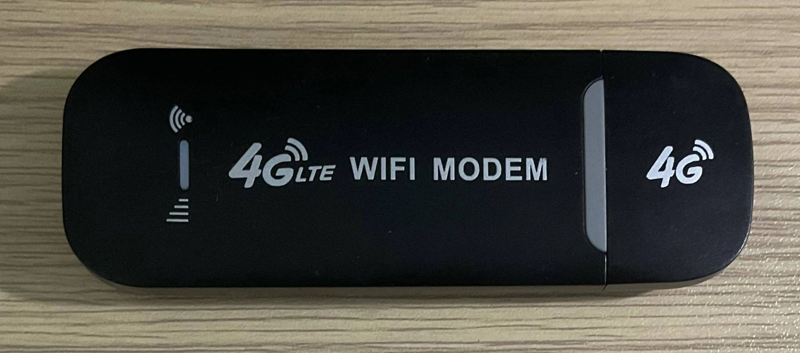
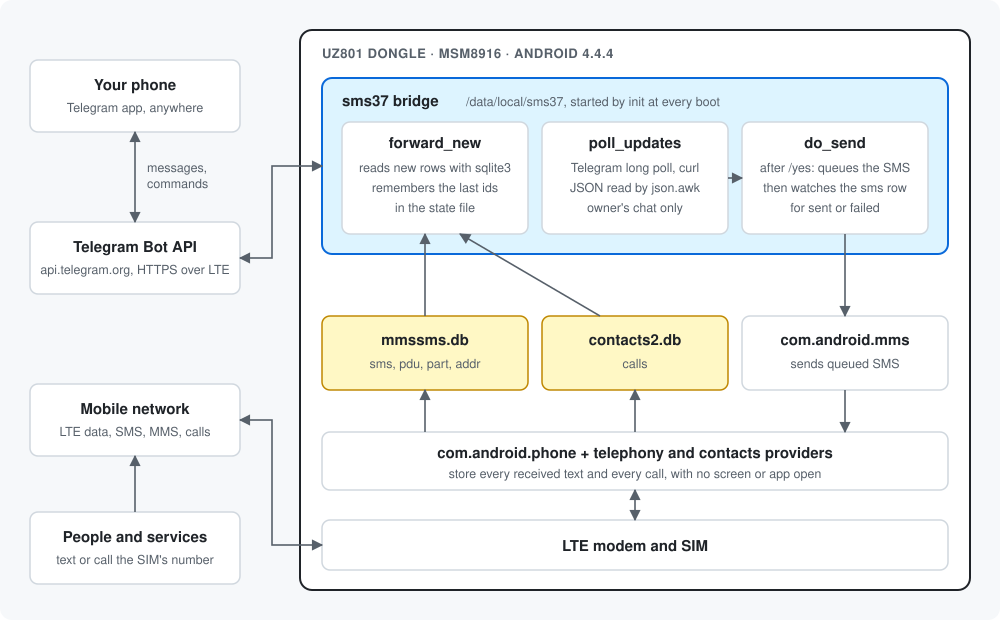
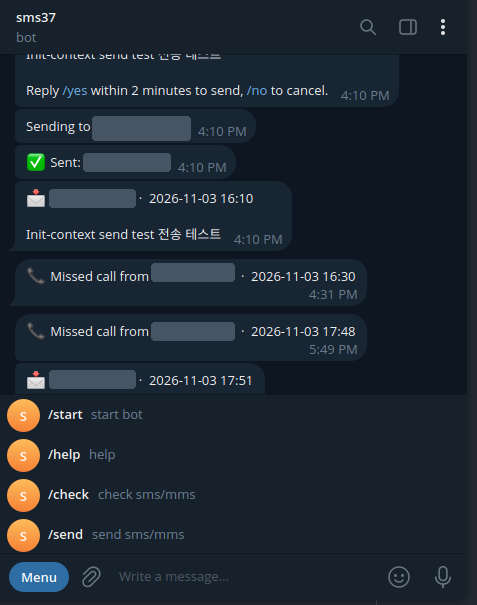

# UZ801 SMS ↔ Telegram bridge

Turn a cheap UZ801 4G USB dongle into a pocket SMS gateway. Put a SIM in it, plug it into any USB power bank, and every text and call that reaches that SIM shows up in your Telegram. You can also send SMS from the same SIM by messaging your bot.

It runs **on the dongle itself**. No PC, no firmware flashing and no Android app: the stick already ships Android 4.4 with a root shell, `curl`, `sqlite3` and BusyBox, so the bridge is a small shell script started at boot.





## What it does

| Feature | How you use it |
|---|---|
| Forward received SMS | Automatic |
| Forward long texts that the carrier delivers as MMS (LMS) | Automatic |
| Report incoming, missed and rejected calls | Automatic, once the call has ended |
| Show recent texts | `/check` or `/check 10` |
| Show recent calls | `/calls` or `/calls 10` |
| Send an SMS, with a confirmation step | `/send 010-0000-0000 hello`, then `/yes` or `/no` |
| Keep working through outages | Retries until LTE is back, then sends what it missed |

Only your own Telegram chat can control the bot. Everyone else is ignored.

The dongle keeps doing its normal job while the bridge runs, so its Wi-Fi hotspot and USB internet still work.



*A real chat with the bridge: an SMS sent, a text received and missed-call alerts, with the command menu below. Phone numbers are covered. You set the menu in @BotFather, and [setup](docs/setup.md#5-create-a-telegram-bot) has the full list, including `/calls`.*

## Quick start

Full steps, with what you should see at each one, are in **[docs/setup.md](docs/setup.md)**.

```bash
git clone https://github.com/jakhon37/uz801-sms-telegram-bridge.git ~/uz801-sms-telegram-bridge
cd ~/uz801-sms-telegram-bridge

sudo apt install adb
sudo adb start-server

# Turn on ADB in the dongle (it restarts; wait about 30 seconds)
curl -X POST -d '{"funcNo":2001}' http://192.168.100.1/ajax
adb devices

bash pc/setup.sh                 # store your bot token, link your chat
dongle/install-boot-hook.sh      # start the bridge at every boot
dongle/install.sh                # copy the bridge over and start it
```

Then unplug the dongle and move it to a power bank. Within a minute or two it connects to LTE and answers in Telegram.

## Guides

| Guide | What's inside |
|---|---|
| [docs/setup.md](docs/setup.md) | Step-by-step install from a new dongle |
| [docs/device.md](docs/device.md) | The hardware and software, USB modes, web API, storage, and how to read all of it yourself |
| [docs/how-it-works.md](docs/how-it-works.md) | Boot sequence, message flows, databases, SELinux and the design choices |
| [docs/operations.md](docs/operations.md) | Logs, updates, token rotation, data use, uninstall and troubleshooting |

## Repository layout

```text
dongle/                     Runs on the stick
  sms37.sh                  The bridge: forwarding, bot commands, sending
  json.awk                  Reads Telegram's JSON (BusyBox awk, UTF-8 safe)
  run.sh                    Restarts sms37.sh if it stops; allows one copy only
  install-recovery.sh       Boot hook; goes in /system/etc
  install-boot-hook.sh      PC script: installs the boot hook once
  install.sh                PC script: copies the bridge and restarts it
pc/                         Runs on your PC
  setup.sh                  Stores the bot token and links your chat
  sms_forward.py            PC version of the bridge, reads the dongle over ADB
  sms-forward.service       systemd user service for the PC version
docs/                       Guides and diagrams
```

## Tested on

One UZ801 stick: firmware V2.3.12, Android 4.4.4, MSM8916, with a KT SIM on LTE in South Korea. UZ801 sticks are sold with different firmware, so run the checks in [docs/device.md](docs/device.md#check-your-stick) before installing on a different one.

## Security

Read this before using it for anything important:

- Texts, including one-time codes, pass through Telegram and are stored in your chat there. Anyone holding your Telegram session can read them.
- The bot token lives on the dongle. Anyone with the stick and a USB cable has a root shell and can read the token and every stored text. Treat the stick like an unlocked phone.
- ADB stays on after setup. It's reachable over USB only: port 5555 was closed on the tested stick.
- Change the dongle's Wi-Fi password and web admin password if they are still the defaults.
- Only use a SIM and number you are allowed to use, and don't send unwanted messages.

## Repository history

The log starts with commits from my earlier ESP32-C3 home weather station (January 2025). That code is on the [`esp32-weather-station`](https://github.com/jakhon37/uz801-sms-telegram-bridge/tree/esp32-weather-station) branch, with private values and third-party images removed. Work on the bridge starts on 3 November 2026.

## License

[MIT](LICENSE)
