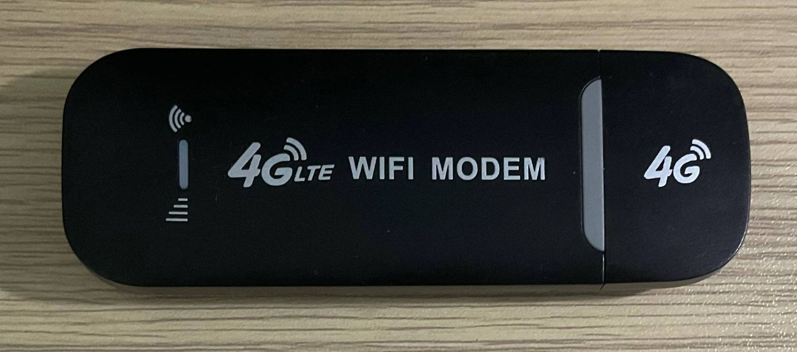
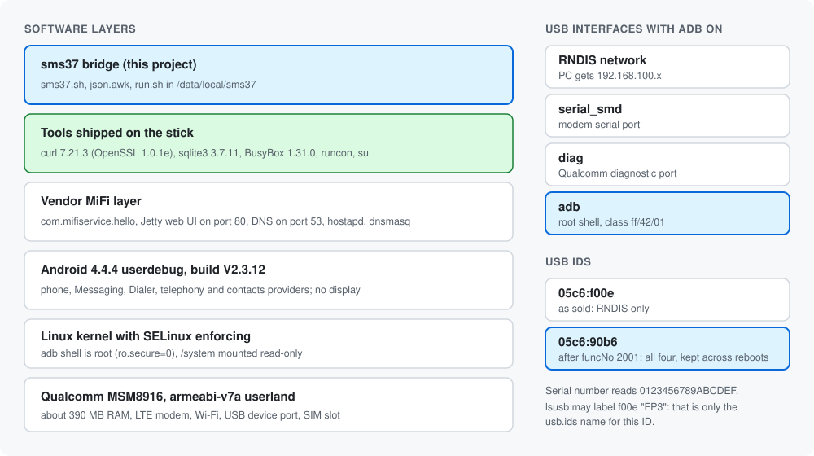
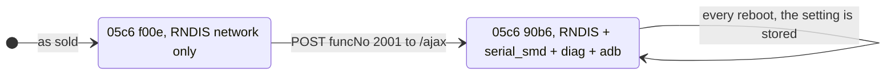

# The UZ801 dongle

The UZ801 is a low-cost USB 4G "WiFi modem" stick. It looks like a simple modem, but inside it's a tiny Android computer with no screen. That's what makes this project possible.



The case only says "4G LTE WIFI MODEM", and similar-looking sticks are sold under many names. The model name `UZ801` comes from the software, so check it with `adb devices -l` (see [setup](setup.md)).

Everything here was read from one stick (firmware V2.3.12, KT SIM, South Korea). The commands are included so you can check your own.



## Summary

| Item | Value | How to read it |
|---|---|---|
| Model | UZ801 | `adb devices -l` |
| Product name | `msm8916_32_512` | `adb devices -l` |
| Chip | Qualcomm MSM8916 | From the product name |
| CPU ABI | `armeabi-v7a` (32-bit userland) | `getprop ro.product.cpu.abi` |
| Android | 4.4.4 | `getprop ro.build.version.release` |
| Firmware | V2.3.12 | `getprop ro.build.display.id` |
| Build type | `userdebug`, `ro.secure=0` | `getprop ro.build.type` |
| ADB shell | Root (`uid=0`), SELinux domain `shell` | `id` |
| SELinux | Enforcing | `getenforce` |
| RAM | 397,824 kB total | `cat /proc/meminfo` |
| `/data` | 774.9 MB, 57 MB used | `df /data` |
| `/system` | 774.9 MB, 277 MB used, mounted read-only | `df /system` |
| Radio status | SIM `READY`, network `LTE` | `getprop gsm.sim.state`, `getprop gsm.network.type` |

Run the `getprop`, `df` and similar commands inside `adb shell`.

## Tools already on the stick

| Tool | Version | Location | Used for |
|---|---|---|---|
| `curl` | 7.21.3, OpenSSL 1.0.1e | `/system/bin` | Telegram HTTPS calls. Supports TLS 1.2, but ships no usable CA bundle, so the install adds one |
| `sqlite3` | 3.7.11 | `/system/xbin` | Reading texts and calls. Too old for `char()` |
| BusyBox | 1.31.0, about 390 applets | `/system/bin` | `awk`, `sed`, `flock`, `setsid`, `date`, and more. Its `xxd` has no `-r` |
| `runcon` | Toolbox | `/system/bin` | Switching SELinux domain |
| `content`, `am` | Android | `/system/bin` | Queueing an SMS, starting the sender |
| `su` | | `/system/xbin` | Not used |

The default shell, `/system/bin/sh`, is mksh. The bridge runs under BusyBox `ash` instead, because mksh hides file descriptor 9 from `flock`.

## USB modes



The setting is stored as the property `persist.sys.usb.config=rndis,serial_smd,diag,adb`. The USB serial number reads `0123456789ABCDEF` on this stick, which suggests it's a placeholder, so don't use it to tell sticks apart.

## Network

| Item | Value |
|---|---|
| Dongle address | `192.168.100.1`, on both USB and Wi-Fi |
| DHCP range | `192.168.100.100` to `192.168.100.200` |
| Open TCP ports found | `53` (DNS), `80` (web UI) |
| Closed | `21`, `22`, `23`, `443`, `5555`, `8080` and others tested |

Port `5555` being closed means ADB works over USB only.

## Web UI and its API

The web UI is a small Jetty server. The pages send JSON to one address:

```text
POST http://192.168.100.1/ajax
{"funcNo": <number>, ...}
```

| `funcNo` | Purpose | Login needed? |
|---|---|---|
| `1000` | Log in (`username`, `password`) | |
| `2001` | Turn on ADB, restarts USB | No |

Pages linked from the menu: `status`, `deviceInformation`, `deviceOperation`, `sim`, `netsel`, `wwanConfig`, `wifiSetting`, `wifiSecurity`, `MacFilter`, `D_HCP`, `modifyPwd`, `upgrade`.

There's no SMS page. The menu holds a dead link to `inbox.asp`, which returns 404.

> **Don't use the "Firmware Upgrade" page unless you have the exact file for your stick.** A wrong file can permanently break the dongle.

## Where the data lives

```text
/data/data/com.android.providers.telephony/databases/mmssms.db    texts
/data/data/com.android.providers.contacts/databases/contacts2.db  calls
```

### Short SMS: table `sms`

| Column | Meaning |
|---|---|
| `_id` | Grows by one with each row, and the bridge remembers the last one |
| `address` | The other party's number |
| `date` | Milliseconds since 1970 |
| `body` | The text |
| `type` | 1 inbox, 2 sent, 3 draft, 4 outbox, 5 failed, 6 queued |

### Long texts: tables `pdu`, `part`, `addr`

Korean carriers deliver long texts (LMS) as MMS, so they don't appear in `sms`. This is why `content://sms/inbox` can look empty while texts are arriving.

| Table | Used for |
|---|---|
| `pdu` | One row per message. Received messages have `msg_box=1` and `m_type=132`. `date` is in seconds |
| `part` | The content. `mid` points to `pdu._id`, and the text is in `text` where `ct='text/plain'` |
| `addr` | Numbers. `msg_id` points to `pdu._id`, and the sender has `type=137` |

### Calls: table `calls`

| Column | Meaning |
|---|---|
| `number` | The caller |
| `date` | Milliseconds since 1970 |
| `duration` | Seconds |
| `type` | 1 answered, 2 outgoing, 3 missed, 4 voicemail, 5 rejected, 6 blocked |

## What the stick can't do

- **Answer calls.** Calls ring and are logged, but the stick has no microphone or speaker. To talk, set up call forwarding to a phone with your carrier.
- **Show anything.** There's no screen, so the bot and the ADB log are your only windows into it.

## Read it yourself

Handy read-only commands, to run with the dongle plugged in:

```bash
# The system
adb shell 'getprop ro.product.model; getprop ro.build.display.id; getprop gsm.operator.alpha; getprop gsm.network.type'

# USB interfaces
lsusb -v -d 05c6:90b6 2>/dev/null | grep -E 'bInterfaceClass|bInterfaceProtocol'

# The last 5 SMS
adb shell 'sqlite3 /data/data/com.android.providers.telephony/databases/mmssms.db "select _id,address,type,body from sms order by _id desc limit 5"'

# The last 5 calls
adb shell 'sqlite3 /data/data/com.android.providers.contacts/databases/contacts2.db "select _id,number,type,duration from calls order by _id desc limit 5"'

# The SIM's own number, in UTF-16 hex dump form, on this firmware
adb shell service call iphonesubinfo 6

# Installed apps
adb shell pm list packages
```

Some of these print personal data, such as numbers, message text and the SIM's own number. Remove it before sharing the output.

## Check your stick

The bridge relies on all of these. If one fails, the dongle version may not work on your firmware. The PC version in `pc/` may still work, because it only needs a root ADB shell plus `content` and `am`: it copies the database and reads it on the PC.

| Check | Command, inside `adb shell` | Needed result |
|---|---|---|
| Root shell | `id` | `uid=0(root)` |
| HTTPS client | `curl --version` | Lists `https` |
| Database reader | `sqlite3 --version` | Prints a version |
| BusyBox | `busybox --list` | Includes `awk`, `flock`, `setsid`, `sed` |
| SELinux switch | `runcon u:r:shell:s0 /system/bin/sh -c id` | Prints a `uid` line |
| Boot hook | `grep flash_recovery /init.rc` | `service flash_recovery /system/etc/install-recovery.sh` |
| Hook is free | `ls /system/etc/install-recovery.sh` | No such file (or our own) |
| SMS database | `ls /data/data/com.android.providers.telephony/databases/` | Lists `mmssms.db` |

Next: [how it works](how-it-works.md) · [setup](setup.md)
