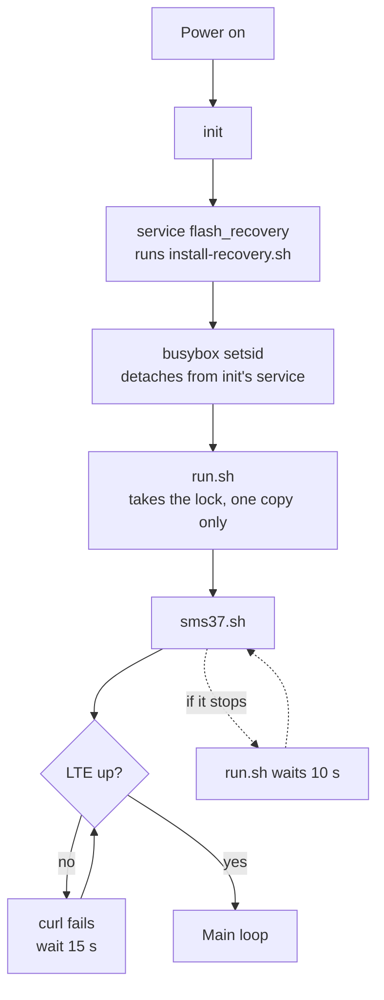
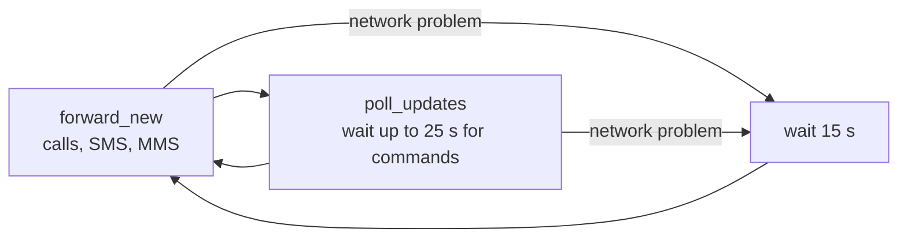
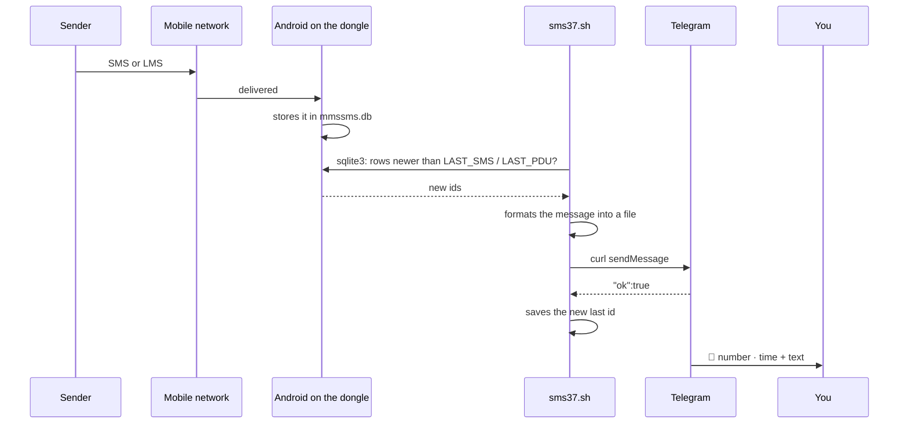
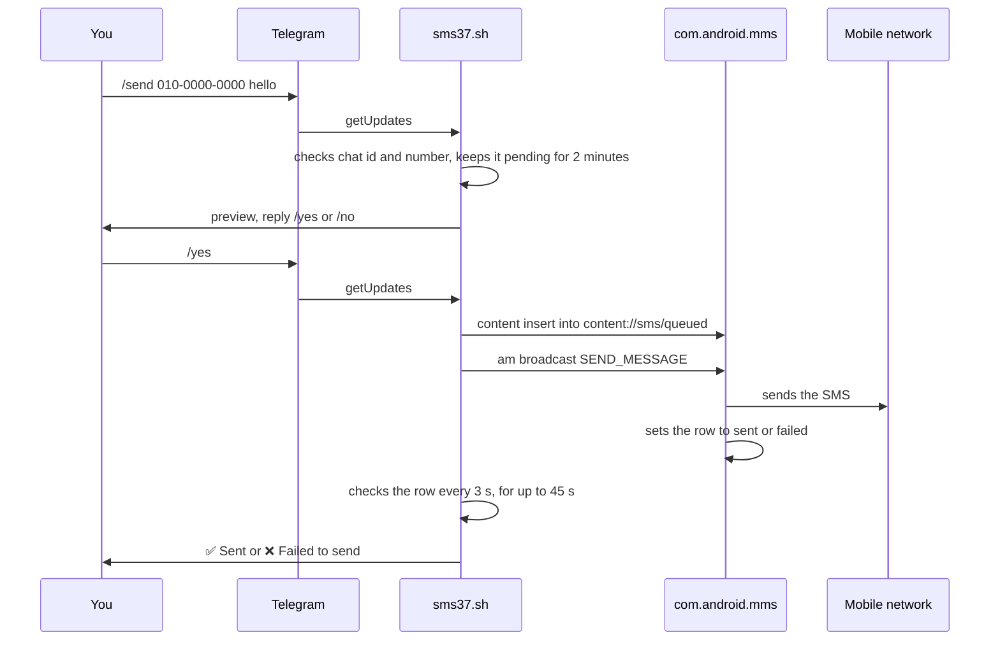
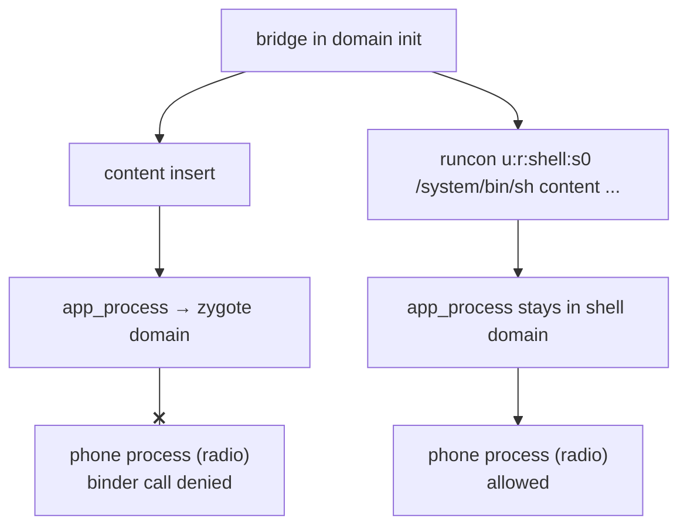

# How it works

The bridge is one shell script with a simple loop. Android already receives and stores every text and call, so the script reads those databases and talks to Telegram.

## Why a shell script on stock firmware

| Option | Result |
|---|---|
| **Shell script on stock Android** (chosen) | No flashing and no build tools. Removing one file and one folder undoes it |
| Android app (APK) | Needs a Java and Android build toolchain, and Android 4.4's old TLS defaults need extra work |
| Flash Linux (OpenStick) | Very capable, but flashing can erase the IMEI and radio calibration, so it needs careful backups first |

The tools on the stick decide the shape of the code: `curl` for HTTPS, `sqlite3` for reading, BusyBox `awk` for JSON.

## Files on the dongle

```text
/system/etc/install-recovery.sh     boot hook
/data/local/sms37/                  owner-only (700)
├── sms37.sh                        the bridge
├── json.awk                        Telegram JSON reader
├── run.sh                          supervisor
├── config                          TOKEN and CHAT (600)
├── cacert.pem                      CA bundle for curl
├── state                           last forwarded ids and Telegram offset
├── log                             trimmed when it passes 200 KB
├── lock                            held by run.sh
├── bin/                            BusyBox applet links, first on PATH
└── tmp/                            working files
```

## Boot

Android's `init.rc` already defines a service that runs `/system/etc/install-recovery.sh` at every boot if the file exists. The firmware doesn't ship that file, so adding it gives a boot hook without changing the boot image.



The clock can read 1970 until the network sets it, so log lines from the first moments after boot show that date. It has no other effect: the bridge tracks messages by id, not by time.

## Main loop



The long poll in `poll_updates` also sets the pace. With nothing to do, the loop runs about every 25 seconds, and commands get an answer almost at once.

## Receiving a text



The last id is saved only after Telegram accepts the message, so nothing is lost if the network drops. If Telegram refuses a message outright, the bridge logs it and moves on rather than retrying forever.

Calls work the same way from the `calls` table. Android writes the row when the call ends, which is why the alert comes after hanging up.

## Sending a text



The body goes to `content` as one quoted shell argument, so characters such as `$`, backticks and quotes in a text are sent exactly as typed and never run. A self-test with those characters, Korean text and a line break arrived unchanged.

## SELinux: why `runcon` is needed

This is the least obvious part of the project.

At boot the bridge runs in the SELinux domain `init`. From there, `content` and `am` start `app_process`, and an automatic rule moves that process into the `zygote` domain. `zygote` isn't allowed to call the phone process over binder, so the SMS insert fails:

```text
avc: denied { call } scontext=u:r:zygote:s0 tcontext=u:r:radio:s0 tclass=binder
binder: transaction failed 29201
```

`content` reports this as `TransactionTooLargeException` or simply prints nothing, and neither points at the real cause.

Commands run from `adb shell` are in the `shell` domain, which is allowed. So **anything tested only over adb can pass and still fail at boot**.



The fix is one helper in `sms37.sh`:

```sh
as_shell() { runcon u:r:shell:s0 /system/bin/sh "$@" </dev/null; }
```

It has to enter through `/system/bin/sh`, since that's the `shell` domain's permitted entry point. Running `runcon u:r:shell:s0 /system/bin/content` directly is denied.

Reading the databases with `sqlite3` needs none of this. It's a native program that opens the files directly, with no binder call.

For the same reason, `install.sh` restarts the bridge through init (`start flash_recovery`), so every test runs the way the dongle does on a power bank. To test one command in that context (this one sends the `/help` reply to your Telegram):

```bash
adb shell 'cd /data/local/sms37; export PATH=$PWD/bin:/system/bin:/system/xbin; printf "/help" > tmp/t; runcon u:r:init:s0 /system/bin/busybox sh sms37.sh cmd tmp/t'
```

## Reading JSON with BusyBox awk

The stick has no `jq` or Python. Telegram also sends non-ASCII text as `\uXXXX` escapes, so Korean and emoji need real decoding. `json.awk` is a small recursive parser that:

- Tracks each value's path, such as `.result[0].message.text`
- Turns `\uXXXX` into UTF-8 bytes, including surrogate pairs for emoji
- Writes each message's text to its own file, `tmp/u<n>.txt`
- Prints `update_id chat_id` lines for the script to read

Keeping the text in a file means quotes, spaces and line breaks in a message can't reach the shell as code.

## Reliability details

| Concern | What the bridge does |
|---|---|
| Running twice | `run.sh` holds a `flock`, so a second copy exits |
| Crash | `run.sh` restarts `sms37.sh` after 10 seconds |
| Handling a command twice | The Telegram offset is saved before the command runs |
| Stale `/yes` after a reboot | Pending sends are cleared at start |
| Long texts | Cut to 3,900 bytes without splitting a UTF-8 character, then `…(cut)` is added |
| First start | Everything already stored counts as seen |
| Token in `ps` | The URL goes to `curl` through a private config file, not the command line |
| Old CA bundle on the stick | `install.sh` copies the PC's bundle. It goes out of date eventually, so rerun `install.sh` if TLS errors appear |

Next: [operations](operations.md) · [the device](device.md)
